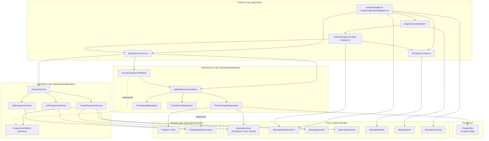

# Programs Module — Implementation Plan

This document defines a detailed implementation plan for the Programs module, mirroring the architectural patterns established by the existing Organization module. It is based on the current Synaptria codebase as of the `foundation/core-platform` branch and does not introduce new architectural conventions.

## Purpose and Scope

Programs group related projects under a strategic initiative within an organization. The Prisma `Program` model, permission constants (`programs.read`, `programs.manage`), application module stub (`programsModule`), and route constant (`routes.programs = '/programs'`) already exist. What is missing is the full vertical slice: domain contracts, persistence adapters, use cases, web delivery, and tests.

### MVP Operations

The Organization module currently implements three operations:

| Organization | Programs equivalent | Notes |
| --- | --- | --- |
| `CreateOrganizationUseCase` | `CreateProgramUseCase` | Write via unit of work; audit + domain event |
| `ListOrganizationsUseCase` | `ListProgramsUseCase` | Read via direct repository injection |
| `SwitchOrganizationUseCase` | *(none)* | Tenant switching is organization-specific |

Programs additionally requires a detail view, so this plan adds:

| Operation | Rationale |
| --- | --- |
| `GetProgramUseCase` | Supports `/programs/[programId]` detail route |

Update and soft-delete use cases are deferred to a follow-up phase. The domain repository interface will include `update` and `softDelete` methods (matching `OrganizationRepository`) so they can be added without interface changes.

### Out of Scope (Phase 1)

- Project assignment and nested project management
- Milestones, risks, deliverables, and finance linkage
- Program owner reassignment UI
- Bulk import/export
- API route handlers (Organization also uses server actions only)

---

## Reference: Organization Module Patterns

Before implementing Programs, study these files as the canonical reference:

| Layer | Reference files |
| --- | --- |
| Application | `packages/application/src/modules/organization/` |
| Domain | `packages/domain/src/organization/` |
| Database | `packages/database/src/organization/` |
| Web wiring | `apps/web/lib/organization-service.ts` |
| Server actions | `apps/web/app/actions/organization/` |
| UI | `apps/web/app/dashboard/components/create-organization-dialog.tsx`, `organization-switcher.tsx` |
| Page | `apps/web/app/dashboard/page.tsx` |

### Patterns to replicate exactly

1. **Module identifier constant** — `programsModule = 'programs' as const` in `index.ts`
2. **Use case classes** — `{Verb}{Entity}UseCase` with `execute(context, input?)`
3. **Service facade** — `ProgramService` delegating to injected use cases
4. **Unit of work** — `ProgramUnitOfWork` + `ProgramTransactionRepositories` for multi-repo writes
5. **Per-use-case context types** — write ops include `requestId`/`correlationId`; read ops are lighter
6. **Validation before transaction** — input normalization in use case; throws `ApplicationError` with `VALIDATION_FAILED` or `CONFLICT`
7. **Domain repository port** — interface in `@synaptria/domain`; Prisma implementation in `@synaptria/database`
8. **Branded IDs** — `identifier()` at the persistence boundary; factory helpers in `@synaptria/core`
9. **Mapper functions** — exported `mapProgram()` alongside repository class
10. **Composition root** — `apps/web/lib/program-service.ts` with `getProgramService()` singleton
11. **Server actions** — `app/actions/programs/`; HTTP/cookie concerns stay in delivery layer
12. **Tests** — colocated `*.test.ts` with in-memory repository stubs; `node:test` + `node:assert/strict`
13. **Constructor injection defaults** — `Clock = new SystemClock()`, `IdGenerator = new CryptoIdGenerator()` on write use cases

### Key difference: tenant scoping

Organization operations are **user-scoped** (cross-tenant membership). Program operations are **organization-scoped**. Every repository query and use case must receive `organizationId` from trusted server-side context (`getRequestContext()`), never from unvalidated client input alone.

---

## Prisma Schema (Existing)

The `Program` model is already defined in `packages/database/prisma/schema.prisma`:

```prisma
model Program {
  id             String        @id @default(uuid())
  organizationId String
  ownerId        String?
  name           String
  code           String?
  description    String?
  indication     String?
  modality       String?
  target         String?
  status         ProgramStatus @default(CONCEPT)
  priority       Priority      @default(MEDIUM)
  startDate      DateTime?
  targetEndDate  DateTime?
  completedAt    DateTime?
  deletedAt      DateTime?
  createdAt      DateTime      @default(now())
  updatedAt      DateTime      @updatedAt

  @@unique([organizationId, name])
  @@unique([organizationId, code])
  @@index([organizationId, status])
  @@index([organizationId, deletedAt])
}
```

**Enums:** `ProgramStatus` (CONCEPT, DISCOVERY, PRECLINICAL, IND_ENABLING, CLINICAL, PARTNERED, ON_HOLD, COMPLETED, TERMINATED), `Priority` (LOW, MEDIUM, HIGH, CRITICAL).

No schema migration is required for Phase 1.

---

## Required Application Classes

**Location:** `packages/application/src/modules/programs/`

### File inventory

| File | Type | Purpose |
| --- | --- | --- |
| `index.ts` | Barrel export | Re-exports public API + `programsModule` constant |
| `program-service.ts` | Facade | Delegates to use cases |
| `program-unit-of-work.ts` | Interface | Transaction boundary for writes |
| `create-program.ts` | Use case | Create program with audit + event |
| `list-programs.ts` | Use case | List programs for current organization |
| `get-program.ts` | Use case | Fetch single program by ID (tenant-scoped) |
| `create-program.test.ts` | Test | Create flow |
| `list-programs.test.ts` | Test | List, sort, filter deleted |
| `get-program.test.ts` | Test | Found, not found, cross-tenant isolation |
| `program-service.test.ts` | Test | Facade delegation |

### `ProgramService`

Mirrors `OrganizationService`:

```typescript
export class ProgramService {
  constructor(
    private readonly createProgramUseCase: CreateProgramUseCase,
    private readonly listProgramsUseCase: ListProgramsUseCase,
    private readonly getProgramUseCase: GetProgramUseCase,
  ) {}

  createProgram(context: CreateProgramContext, input: CreateProgramInput): Promise<CreateProgramOutput>;
  listPrograms(context: ListProgramsContext): Promise<ListProgramsOutput>;
  getProgram(context: GetProgramContext, input: GetProgramInput): Promise<GetProgramOutput>;
}
```

### `ProgramUnitOfWork`

Mirrors `OrganizationUnitOfWork`. Programs do not need `MembershipRepository`:

```typescript
export interface ProgramTransactionRepositories {
  readonly programs: ProgramRepository;
  readonly audit: AuditRepository;
  readonly events: EventRepository;
}

export interface ProgramUnitOfWork {
  execute<T>(
    operation: (repositories: ProgramTransactionRepositories) => Promise<T>,
  ): Promise<T>;
}
```

### Use case specifications

#### `CreateProgramUseCase`

| Aspect | Detail |
| --- | --- |
| **Constructor** | `unitOfWork: ProgramUnitOfWork`, `clock?: Clock`, `eventIdGenerator?: IdGenerator` |
| **Context** | `CreateProgramContext { organizationId, userId, requestId, correlationId }` |
| **Input** | `CreateProgramInput { name, code?, description?, indication?, modality?, target?, status?, priority?, startDate?, targetEndDate? }` |
| **Output** | `CreateProgramOutput { program: Program }` |
| **Transaction** | Yes |
| **Errors** | Throws `ApplicationError`: `CONFLICT` (duplicate name/code), `VALIDATION_FAILED` |
| **Side effects** | Audit `CREATE` on `Program`; event `program.created` via `DomainEventService.publish()` |

Validation runs **before** opening the transaction (same as `CreateOrganizationUseCase`):

- `name` — required, trimmed, max length aligned with schema
- `code` — optional; if provided, uppercase alphanumeric + hyphens; unique per org
- `status` — optional; must be valid `ProgramStatus` enum value
- `priority` — optional; must be valid `Priority` enum value
- Date fields — `startDate` must precede `targetEndDate` when both provided

Inside the transaction:

1. Check `findByName(organizationId, name)` and `findByCode(organizationId, code)` for conflicts
2. Create program with `ownerId = context.userId` (default owner is creator)
3. Record audit entry
4. Publish domain event

Audit payload (`after`):

```typescript
{ id, name, code, status, priority, ownerId }
```

Event payload:

```typescript
{
  type: 'program.created',
  aggregateType: 'Program',
  aggregateId: program.id,
  payload: { programId, organizationId, name, code, status, createdByUserId }
}
```

#### `ListProgramsUseCase`

| Aspect | Detail |
| --- | --- |
| **Constructor** | `programs: ProgramRepository` (direct injection, no UoW) |
| **Context** | `ListProgramsContext { organizationId }` |
| **Input** | none |
| **Output** | `ListProgramsOutput { programs: readonly ProgramListItem[] }` |
| **Transaction** | No |
| **Errors** | None expected; returns empty array |
| **Side effects** | None |

`ProgramListItem` includes the `Program` entity plus optional summary fields for the list view (project count can be added later; Phase 1 mirrors organization list simplicity).

Application-layer defensive filter: exclude programs where `deletedAt !== undefined` (same pattern as `ListOrganizationsUseCase` filtering inaccessible summaries).

Sort: alphabetical by `name`, then by `code` (mirrors `compareOrganizationSummaries`).

#### `GetProgramUseCase`

| Aspect | Detail |
| --- | --- |
| **Constructor** | `programs: ProgramRepository` |
| **Context** | `GetProgramContext { organizationId }` |
| **Input** | `GetProgramInput { programId: ProgramId }` |
| **Output** | `GetProgramOutput { program: Program }` |
| **Transaction** | No |
| **Errors** | Throws `ApplicationError` with code `NOT_FOUND` |
| **Side effects** | None |

Repository call: `findById(organizationId, programId)` — returns `null` if program belongs to another org or is soft-deleted.

### Public exports (`index.ts`)

```typescript
export * from './create-program';
export * from './get-program';
export * from './list-programs';
export * from './program-service';
export * from './program-unit-of-work';

export const programsModule = 'programs' as const;
```

Update `packages/application/src/index.ts` — already exports `./modules/programs`; no change needed once files exist.

---

## Repository Interfaces

**Location:** `packages/domain/src/programs/`

### File inventory

| File | Purpose |
| --- | --- |
| `index.ts` | Re-exports models and repository |
| `models.ts` | Domain types |
| `program-repository.ts` | `ProgramRepository` interface + input types |

Export from `packages/domain/src/index.ts`:

```typescript
export * from './programs';
```

### Domain models (`models.ts`)

```typescript
export type ProgramStatus =
  | 'CONCEPT'
  | 'DISCOVERY'
  | 'PRECLINICAL'
  | 'IND_ENABLING'
  | 'CLINICAL'
  | 'PARTNERED'
  | 'ON_HOLD'
  | 'COMPLETED'
  | 'TERMINATED';

export type ProgramPriority = 'LOW' | 'MEDIUM' | 'HIGH' | 'CRITICAL';

export interface Program {
  readonly id: ProgramId;
  readonly organizationId: OrganizationId;
  readonly ownerId?: UserId;
  readonly name: string;
  readonly code?: string;
  readonly description?: string;
  readonly indication?: string;
  readonly modality?: string;
  readonly target?: string;
  readonly status: ProgramStatus;
  readonly priority: ProgramPriority;
  readonly startDate?: Date;
  readonly targetEndDate?: Date;
  readonly completedAt?: Date;
  readonly deletedAt?: Date;
  readonly createdAt: Date;
  readonly updatedAt: Date;
}
```

Domain enums mirror Prisma enums as string union types (same approach as `MembershipStatus` in organization models).

### `ProgramRepository` interface

Mirrors `OrganizationRepository` method naming and input/output separation:

```typescript
export interface CreateProgramInput {
  readonly organizationId: OrganizationId;
  readonly ownerId?: UserId;
  readonly name: string;
  readonly code?: string;
  readonly description?: string;
  readonly indication?: string;
  readonly modality?: string;
  readonly target?: string;
  readonly status?: ProgramStatus;
  readonly priority?: ProgramPriority;
  readonly startDate?: Date;
  readonly targetEndDate?: Date;
}

export interface UpdateProgramInput {
  readonly name?: string;
  readonly code?: string | null;
  readonly description?: string | null;
  readonly indication?: string | null;
  readonly modality?: string | null;
  readonly target?: string | null;
  readonly status?: ProgramStatus;
  readonly priority?: ProgramPriority;
  readonly ownerId?: UserId | null;
  readonly startDate?: Date | null;
  readonly targetEndDate?: Date | null;
  readonly completedAt?: Date | null;
}

export interface ProgramRepository {
  create(input: CreateProgramInput): Promise<Program>;
  findById(organizationId: OrganizationId, id: ProgramId): Promise<Program | null>;
  findByName(organizationId: OrganizationId, name: string): Promise<Program | null>;
  findByCode(organizationId: OrganizationId, code: string): Promise<Program | null>;
  update(organizationId: OrganizationId, id: ProgramId, input: UpdateProgramInput): Promise<Program>;
  softDelete(organizationId: OrganizationId, id: ProgramId, deletedAt: Date): Promise<Program>;
  listForOrganization(organizationId: OrganizationId): Promise<readonly Program[]>;
}
```

**Tenant isolation rule:** Every method accepts `organizationId` as an explicit parameter. No method accepts only a program ID.

---

## Prisma Repository Implementation

**Location:** `packages/database/src/programs/`

### File inventory

| File | Purpose |
| --- | --- |
| `index.ts` | Exports repository, mapper, client type alias |
| `prisma-program-repository.ts` | `PrismaProgramRepository` + `mapProgram()` |

### `PrismaProgramRepository`

Follow `PrismaOrganizationRepository` patterns exactly:

```typescript
export type ProgramDatabaseClient = Pick<PrismaClient, 'program'>;

export class PrismaProgramRepository implements ProgramRepository {
  constructor(private readonly client: ProgramDatabaseClient) {}
  // ...
}
```

### Query scoping

Every query includes `organizationId` and `deletedAt: null` for reads:

```typescript
async findById(organizationId: OrganizationId, id: ProgramId): Promise<Program | null> {
  const row = await this.client.program.findFirst({
    where: { id, organizationId, deletedAt: null },
  });
  return row === null ? null : mapProgram(row);
}
```

```typescript
async listForOrganization(organizationId: OrganizationId): Promise<readonly Program[]> {
  const rows = await this.client.program.findMany({
    where: { organizationId, deletedAt: null },
    orderBy: [{ name: 'asc' }, { code: 'asc' }],
  });
  return rows.map(mapProgram);
}
```

Conflict checks (`findByName`, `findByCode`) also scope by `organizationId` and exclude soft-deleted rows.

### `mapProgram()`

Export alongside the repository (same as `mapOrganization`):

```typescript
export function mapProgram(row: PrismaProgram): Program {
  return {
    id: identifier(row.id, 'ProgramId') as ProgramId,
    organizationId: identifier(row.organizationId, 'OrganizationId') as OrganizationId,
    ...(row.ownerId === null ? {} : { ownerId: userId(row.ownerId) }),
    name: row.name,
    ...(row.code === null ? {} : { code: row.code }),
    // ... omit null optional fields
    status: row.status as ProgramStatus,
    priority: row.priority as ProgramPriority,
    ...(row.deletedAt === null ? {} : { deletedAt: row.deletedAt }),
    createdAt: row.createdAt,
    updatedAt: row.updatedAt,
  };
}
```

### Extend shared persistence wiring

Update `packages/database/src/transaction.ts`:

```typescript
export interface PersistenceRepositories {
  readonly audit: PrismaAuditRepository;
  readonly events: PrismaEventRepository;
  readonly memberships: PrismaMembershipRepository;
  readonly organizations: PrismaOrganizationRepository;
  readonly programs: PrismaProgramRepository;  // add
}

export function createPersistenceRepositories(client): PersistenceRepositories {
  return {
    // ...existing
    programs: new PrismaProgramRepository(client),
  };
}
```

Export from `packages/database/src/index.ts` via `export * from './programs'`.

### Branded ID prerequisite

Add to `packages/core/src/ids/identifier.ts` (Organization module established this pattern):

```typescript
export type ProgramId = Identifier<'ProgramId'>;
export const programId = (value: string): ProgramId => identifier(value, 'ProgramId');
```

Re-export from `@synaptria/core` public API.

---

## Server Actions

**Location:** `apps/web/app/actions/programs/`

### `create-program.ts`

Mirror `apps/web/app/actions/organization/create-organization.ts`:

| Aspect | Detail |
| --- | --- |
| Directive | `'use server'` |
| Pattern | `useActionState`-compatible with `CreateProgramActionState` |
| Auth | `getRequestContext()` for tenant context |
| Permission | `requirePermission(context, PERMISSIONS.PROGRAMS_MANAGE)` — **new vs Organization**; permissions already exist for programs |
| Service call | `getProgramService().createProgram({ organizationId, userId, requestId, correlationId }, input)` |
| Client validation | Required `name`; optional `code` format check |
| Error mapping | `ApplicationError` → field errors (`name`, `code`) or summary message |
| Success | `redirect('/programs')` or `redirect(`/programs/${result.program.id}`)` |

`CreateProgramActionState`:

```typescript
export interface CreateProgramActionState {
  readonly status: 'idle' | 'error';
  readonly message?: string;
  readonly fieldErrors?: Readonly<{ name?: string; code?: string; /* ... */ }>;
  readonly values?: Readonly<{ name: string; code: string; /* ... */ }>;
}

export const initialCreateProgramState: CreateProgramActionState = { status: 'idle' };
```

No cookie manipulation (unlike organization create/switch).

### Context mapping helper

Add a small helper in `apps/web/lib/request-context.ts` or a new `apps/web/lib/application-context.ts` to map `ResolvedOrganizationContext` → use case contexts:

```typescript
export function toCreateProgramContext(context: ResolvedOrganizationContext): CreateProgramContext {
  return {
    organizationId: context.organizationId,
    userId: context.userId,
    requestId: context.requestId,
    correlationId: context.correlationId,
  };
}

export function toListProgramsContext(context: ResolvedOrganizationContext): ListProgramsContext {
  return { organizationId: context.organizationId };
}
```

This avoids repeating field mapping in every server action (Organization actions inline the mapping today; a helper is acceptable for Programs since all operations require full tenant context).

---

## UI Components

**Location:** `apps/web/app/programs/components/`

Organize under the programs route (Organization embeds components in `dashboard/components/` because org management is header-level; Programs is a dedicated module with its own route namespace).

### Component inventory

| Component | Type | Purpose |
| --- | --- | --- |
| `create-program-dialog.tsx` | `'use client'` | Dialog + form; `useActionState`; mirrors `CreateOrganizationDialog` |
| `program-list.tsx` | Server or client | Renders program table/cards from list data |
| `program-status-badge.tsx` | Presentational | Maps `ProgramStatus` to styled badge |
| `program-priority-badge.tsx` | Presentational | Maps `Priority` to styled badge |
| `programs-empty-state.tsx` | Presentational | Shown when organization has no programs |
| `program-detail-header.tsx` | Server | Program name, status, priority, metadata on detail page |

### `create-program-dialog.tsx`

Mirror `create-organization-dialog.tsx`:

- Native `<dialog>` element with open/close controls
- `useActionState(createProgramAction, initialCreateProgramState)`
- `useFormStatus` for submit button pending state
- Accessible labels, `aria-invalid`, `role="alert"` error summary
- Auto-generate `code` from `name` unless user manually edits code (same slug pattern as organization)
- Fields for Phase 1: `name` (required), `code` (optional), `description` (optional)
- Extended fields (`indication`, `modality`, `target`, dates) can be hidden or omitted in Phase 1

### `program-list.tsx`

- Accept `programs: readonly ProgramListItem[]` as props from server page
- Render responsive table using shared `@synaptria/ui` primitives (`Card`, `Stack`)
- Each row links to `/programs/[programId]`
- Show status and priority badges
- Include "New program" button triggering `CreateProgramDialog`

### Styling

Reuse existing CSS classes from `apps/web/app/globals.css` (`.organization-dialog`, `.form-field`, `.primary-button`, etc.). Add program-specific classes only when necessary (`.program-list`, `.program-status-badge`).

---

## Routing

**Location:** `apps/web/app/programs/`

Routes are already defined in `@synaptria/config` as `routes.programs = '/programs'`.

### Route inventory

| Route | File | Type | Purpose |
| --- | --- | --- | --- |
| `/programs` | `app/programs/page.tsx` | Server component | List all programs for active organization |
| `/programs/[programId]` | `app/programs/[programId]/page.tsx` | Server component | Program detail view |

No API routes in Phase 1 (consistent with Organization module).

### `/programs` page

Mirror `apps/web/app/dashboard/page.tsx` auth error handling:

```typescript
export default async function ProgramsPage() {
  let context: ResolvedOrganizationContext;

  try {
    context = await getRequestContext();
  } catch (error) {
    if (error instanceof AuthenticationError) redirect('/sign-in');
    if (error instanceof OrganizationMembershipRequiredError) redirect('/no-organization');
    throw error;
  }

  requirePermission(context, PERMISSIONS.PROGRAMS_READ);

  const programList = await getProgramService().listPrograms({
    organizationId: context.organizationId,
  });

  return (/* header + ProgramList + CreateProgramDialog */);
}
```

### `/programs/[programId]` page

```typescript
export default async function ProgramDetailPage({ params }: { params: Promise<{ programId: string }> }) {
  const { programId: rawProgramId } = await params;
  const context = await getRequestContext(); // with same error handling
  requirePermission(context, PERMISSIONS.PROGRAMS_READ);

  const result = await getProgramService().getProgram(
    { organizationId: context.organizationId },
    { programId: programId(rawProgramId) },
  );

  return (/* ProgramDetailHeader + placeholder sections for projects, risks, etc. */);
}
```

Map `ApplicationError` with `NOT_FOUND` to Next.js `notFound()`.

### Navigation integration

Update `apps/web/app/dashboard/page.tsx`:

- Change Programs card from static `'0 active'` to dynamic count from `listPrograms`
- Link Programs card to `routes.programs`
- Optionally add active nav link styling when `@synaptria/config` `primaryNavigation` Programs item is implemented as `<a href>`

Consider a shared layout at `app/programs/layout.tsx` for consistent module header and breadcrumb (optional Phase 1 enhancement).

### Web composition root

**File:** `apps/web/lib/program-service.ts`

Mirror `organization-service.ts`:

```typescript
class PrismaProgramUnitOfWork implements ProgramUnitOfWork {
  async execute<T>(operation): Promise<T> {
    return withDatabaseTransaction(db, async (repositories) => {
      return operation({
        programs: repositories.programs,
        audit: repositories.audit,
        events: repositories.events,
      });
    });
  }
}

const repositories = createPersistenceRepositories(db);
const programUnitOfWork = new PrismaProgramUnitOfWork();

const programService = new ProgramService(
  new CreateProgramUseCase(programUnitOfWork),
  new ListProgramsUseCase(repositories.programs),
  new GetProgramUseCase(repositories.programs),
);

export function getProgramService(): ProgramService {
  return programService;
}
```

---

## Testing Strategy

Follow Organization module test conventions: colocated unit tests in the application package, in-memory repository stubs, deterministic clock/ID injection.

### Application layer unit tests

| Test file | Scenarios |
| --- | --- |
| `create-program.test.ts` | Happy path (program + audit + event); duplicate name (`CONFLICT`, zero UoW executions); duplicate code; invalid input (`VALIDATION_FAILED`); invalid date range |
| `list-programs.test.ts` | Alphabetical sort; empty list; excludes soft-deleted programs; defensive filter |
| `get-program.test.ts` | Found program; `NOT_FOUND` for missing ID; `NOT_FOUND` when program belongs to different org (tenant isolation) |
| `program-service.test.ts` | Facade delegates context/input to each use case stub |

### Test infrastructure patterns (from Organization)

Reuse these patterns from `create-organization.test.ts`:

- `InMemoryProgramRepository` implementing `ProgramRepository`
- `InMemoryUnitOfWork` / `UnitOfWorkStub` wrapping `{ programs, audit, events }`
- `FixedClock` with constant `NOW`
- `FixedIdGenerator` returning `'event-1'`
- Capture `AuditRepository.record` and `EventRepository.publish` calls to assert side effects
- Assert UoW `execute` call count is zero when validation fails before transaction

### Database layer integration tests

**File:** `packages/database/src/programs/prisma-program-repository.test.ts`

| Scenario | Assertion |
| --- | --- |
| Create and find by ID | Round-trip mapping via `mapProgram` |
| Tenant isolation | `findById(wrongOrgId, programId)` returns `null` |
| Soft delete | Deleted programs excluded from `listForOrganization` |
| Unique constraints | Duplicate name/code within org rejected by Prisma |

Requires test database or transactional test setup consistent with existing `prisma-audit-repository.test.ts` and `prisma-event-repository.test.ts` patterns.

### Web layer tests (Phase 1 optional)

Organization module has no web-layer tests today. For Programs, defer end-to-end tests unless the project's E2E infrastructure is ready. If added:

- Authenticated user with `PROGRAMS_READ` can view `/programs`
- User without permission receives authorization error
- Create program flow redirects to program list/detail
- Cross-tenant access to `/programs/[otherOrgProgramId]` returns 404

### Tenant isolation test matrix

| Test | Layer | Expected |
| --- | --- | --- |
| List programs for org A | Application | Returns only org A programs |
| Get program from org B using org A context | Application | `NOT_FOUND` |
| `findById` with wrong `organizationId` | Database | `null` |
| Server action with tampered program ID | Web | `NOT_FOUND` via use case |

---

## Dependency Diagram



### Dependency direction summary

| From | To | Allowed |
| --- | --- | --- |
| `apps/web` | `@synaptria/application`, `@synaptria/database`, `@synaptria/auth`, `@synaptria/permissions`, `@synaptria/core`, `@synaptria/ui`, `@synaptria/config` | Yes |
| `@synaptria/application` | `@synaptria/domain`, `@synaptria/core`, `@synaptria/audit`, `@synaptria/events` | Yes |
| `@synaptria/application` | `@synaptria/database`, Next.js, React | No |
| `@synaptria/domain` | `@synaptria/core` | Yes |
| `@synaptria/domain` | Prisma, `@synaptria/application` | No |
| `@synaptria/database` | `@synaptria/domain`, Prisma | Yes |

---

## Implementation Order

Execute in this sequence to maintain compilable increments and respect layer dependencies.

### Step 1 — Core branded identifier

| Task | Files |
| --- | --- |
| Add `ProgramId` type and `programId()` factory | `packages/core/src/ids/identifier.ts` |

**Verification:** `pnpm typecheck` in `@synaptria/core`.

### Step 2 — Domain layer

| Task | Files |
| --- | --- |
| Define `Program` model and status/priority types | `packages/domain/src/programs/models.ts` |
| Define `ProgramRepository` interface | `packages/domain/src/programs/program-repository.ts` |
| Barrel export | `packages/domain/src/programs/index.ts` |
| Re-export from domain root | `packages/domain/src/index.ts` |

**Verification:** `pnpm typecheck` in `@synaptria/domain`.

### Step 3 — Database persistence adapter

| Task | Files |
| --- | --- |
| Implement `PrismaProgramRepository` + `mapProgram` | `packages/database/src/programs/prisma-program-repository.ts` |
| Barrel export | `packages/database/src/programs/index.ts` |
| Add `programs` to `PersistenceRepositories` | `packages/database/src/transaction.ts` |
| Re-export | `packages/database/src/index.ts` |
| Integration tests | `packages/database/src/programs/prisma-program-repository.test.ts` |

**Verification:** `pnpm test` in `@synaptria/database`.

### Step 4 — Application layer

| Task | Files |
| --- | --- |
| Define `ProgramUnitOfWork` | `program-unit-of-work.ts` |
| Implement use cases | `create-program.ts`, `list-programs.ts`, `get-program.ts` |
| Implement facade | `program-service.ts` |
| Update barrel export | `index.ts` (replace stub) |
| Unit tests | `*.test.ts` (4 files) |

**Verification:** `pnpm test` in `@synaptria/application`.

### Step 5 — Web composition root

| Task | Files |
| --- | --- |
| Wire service singleton | `apps/web/lib/program-service.ts` |
| Add context mapping helpers | `apps/web/lib/request-context.ts` or `application-context.ts` |

**Verification:** `pnpm typecheck` in `apps/web`.

### Step 6 — Server actions

| Task | Files |
| --- | --- |
| Create program action | `apps/web/app/actions/programs/create-program.ts` |

**Verification:** Manual or unit test of action error mapping.

### Step 7 — UI components

| Task | Files |
| --- | --- |
| Create program dialog | `apps/web/app/programs/components/create-program-dialog.tsx` |
| Program list | `program-list.tsx` |
| Status/priority badges | `program-status-badge.tsx`, `program-priority-badge.tsx` |
| Empty state | `programs-empty-state.tsx` |

**Verification:** Visual review in local dev.

### Step 8 — Routes and pages

| Task | Files |
| --- | --- |
| Programs list page | `apps/web/app/programs/page.tsx` |
| Program detail page | `apps/web/app/programs/[programId]/page.tsx` |
| Optional module layout | `apps/web/app/programs/layout.tsx` |
| Dashboard integration | Update `apps/web/app/dashboard/page.tsx` for program count + link |

**Verification:** Navigate `/programs`, create a program, view detail page.

### Step 9 — Documentation and cleanup

| Task | Files |
| --- | --- |
| Expand product doc | `docs/03-product/programs.md` |
| Update architecture docs if patterns change | `docs/01-architecture/layers.md` (module list only) |

**Verification:** Full monorepo check: `pnpm lint && pnpm typecheck && pnpm test`.

---

## Permissions

Existing permissions in `@synaptria/permissions`:

| Permission | Roles |
| --- | --- |
| `programs.read` | OWNER, ADMIN, MEMBER, VIEWER |
| `programs.manage` | OWNER, ADMIN, MEMBER |

Wire in the **delivery layer** (server actions and pages):

```typescript
import { PERMISSIONS, requirePermission } from '@synaptria/permissions';

requirePermission(
  { organizationId: context.organizationId, role: context.role },
  PERMISSIONS.PROGRAMS_READ,
);
```

The Organization module does not yet call `requirePermission`. Programs should wire permissions from the start because the constants and role mappings already exist. This does not change the architectural pattern—it adds delivery-layer authorization that Organization will eventually need as well.

---

## Audit and Event Catalog

| Operation | Audit action | Event type |
| --- | --- | --- |
| Create program | `CREATE` on `Program` | `program.created` |

Future operations (not Phase 1):

| Operation | Audit action | Event type |
| --- | --- | --- |
| Update program | `UPDATE` on `Program` | `program.updated` |
| Soft delete program | `DELETE` on `Program` | `program.deleted` |
| Change status | `UPDATE` on `Program` | `program.status_changed` |

---

## Checklist Before Marking Complete

- [ ] `ProgramId` branded type exported from `@synaptria/core`
- [ ] Domain models and `ProgramRepository` port defined
- [ ] `PrismaProgramRepository` scopes all queries by `organizationId`
- [ ] `PersistenceRepositories` includes `programs`
- [ ] Three use cases + `ProgramService` + `ProgramUnitOfWork` implemented
- [ ] Unit tests pass with tenant isolation coverage
- [ ] `getProgramService()` composition root wired
- [ ] Server action with permission check and error mapping
- [ ] `/programs` and `/programs/[programId]` pages render
- [ ] Dashboard Programs card shows live count and links to module
- [ ] `pnpm lint && pnpm typecheck && pnpm test` pass
- [ ] No Prisma models leak into application or delivery layers

---

## Further Reading

- [Organization module (application)](../../packages/application/src/modules/organization/)
- [Product: Programs](../03-product/programs.md)
- [Layered architecture](../01-architecture/layers.md)
- [Coding standards](../01-architecture/coding-standards.md)
- [Authorization](../01-architecture/authorization.md)
- [Request context](../01-architecture/request-context.md)
