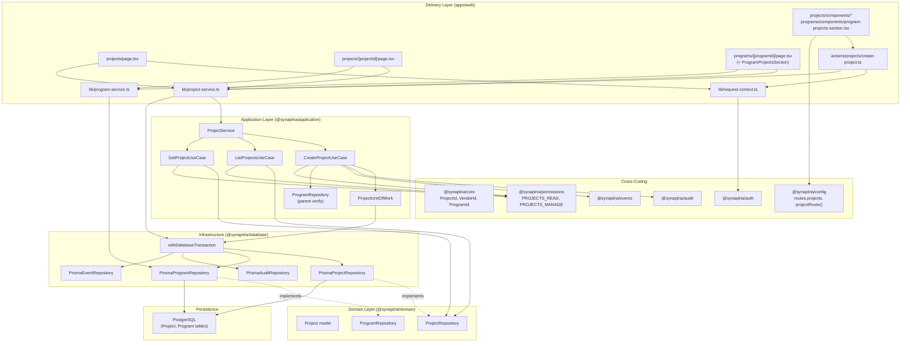

# Projects Module — Implementation Plan

This document defines a detailed implementation plan for the Projects module, using the completed **Programs vertical slice** as the primary reference implementation. It is based on the current Synaptria codebase on the `feature/projects` branch and does not introduce new architectural conventions beyond what Programs established.

## Purpose and Scope

Projects represent scientific and operational execution work. In the data model, a project optionally belongs to a **Program** (`programId` is nullable) and always belongs to an **Organization**. The Prisma `Project` model, route constant (`routes.projects = '/projects'`), and primary navigation entry already exist. What is missing is the full vertical slice: permissions, domain contracts, persistence adapters, use cases, web delivery, and tests.

### MVP Operations

Mirror the Programs Phase 1 surface:

| Programs (shipped) | Projects equivalent | Notes |
| --- | --- | --- |
| `CreateProgramUseCase` | `CreateProjectUseCase` | Write via unit of work; audit + domain event |
| `ListProgramsUseCase` | `ListProjectsUseCase` | Read via direct repository injection; supports org-wide and program-scoped listing |
| `GetProgramUseCase` | `GetProjectUseCase` | Supports `/projects/[projectId]` detail route |
| `/programs` list page | `/projects` list page | Organization-wide portfolio of projects |
| `/programs/[programId]` detail | `/programs/[programId]` projects section | Program-scoped project list embedded on existing program detail page |
| Create program dialog | Create project dialog | Minimal fields; optional `programId` when launched from a program |

Update and soft-delete **use cases** are deferred to a follow-up phase (matching Programs). The domain repository interface will include `update` and `softDelete` so they can be added without interface changes.

### Out of Scope (Phase 1)

- Milestones, deliverables, risks, decisions, dependencies, and finance linkage
- Vendor assignment UI (`vendorId` remains on the domain model but is not editable in MVP forms)
- Owner reassignment UI (`ownerId` set from authenticated user on create, same as Programs)
- Bulk import/export
- API route handlers (Programs uses server actions only)
- Standalone `/programs/[programId]/projects` route (projects are a section on the program detail page instead)

No Prisma schema migration is required for Phase 1.

---

## Reference: Programs Module (Primary)

Study these shipped files as the canonical reference before implementing Projects:

### Inspected files

| Layer | Files |
| --- | --- |
| Core identifiers | `packages/core/src/ids/identifier.ts`, `packages/core/src/ids/identifier.test.ts` |
| Domain | `packages/domain/src/programs/models.ts`, `program-repository.ts`, `index.ts` |
| Application | `packages/application/src/modules/programs/create-program.ts`, `list-programs.ts`, `get-program.ts`, `program-service.ts`, `program-unit-of-work.ts`, `index.ts`, `*.test.ts` |
| Database | `packages/database/src/programs/prisma-program-repository.ts`, `prisma-program-repository.test.ts`, `index.ts`; `packages/database/src/transaction.ts`, `prisma-errors.ts` |
| Web composition | `apps/web/lib/program-service.ts`, `program-context.ts`, `program-service.test.ts`, `program-context.test.ts`, `request-context.ts` |
| Server actions | `apps/web/app/actions/programs/create-program.ts`, `create-program-form.ts`, `create-program-form.test.ts` |
| List page | `apps/web/app/programs/page.tsx`, `components/programs-page-header.tsx`, `programs-list.tsx`, `program-card.tsx`, `programs-empty-state.tsx`, `program-status-badge.tsx`, `program-priority-badge.tsx` |
| Detail page | `apps/web/app/programs/[programId]/page.tsx`, `components/program-detail-header.tsx`, `program-detail-metadata.tsx` |
| Create dialog | `apps/web/app/programs/components/create-program-dialog.tsx` |
| Formatting helpers | `apps/web/app/programs/programs-format.ts`, `programs-format.test.ts` |
| Styles | `apps/web/app/globals.css` (`.programs-page`, `.program-card`, `.program-detail-*`) |
| Config / routes | `packages/config/src/index.ts` (`routes.projects`, `programRoute()`) |
| Permissions | `packages/permissions/src/permissions.ts`, `roles.ts`, `permissions.test.ts` |
| Prisma schema | `packages/database/prisma/schema.prisma` (`Project`, `ProjectStatus`, `Priority`, `Program.projects`) |
| Product context | `docs/03-product/projects.md`, `docs/modules/programs-implementation-plan.md` |

### Patterns to replicate exactly

1. **Module identifier constant** — `projectsModule = 'projects' as const` in `index.ts`
2. **Use case classes** — `{Verb}{Entity}UseCase` with `execute(context, input?)`
3. **Service facade** — `ProjectService` delegating to injected use cases
4. **Unit of work** — `ProjectUnitOfWork` + `ProjectTransactionRepositories` for multi-repo writes
5. **Per-use-case context types** — write ops include `requestId`/`correlationId`; read ops are lighter
6. **Validation before / inside transaction** — normalization in use case; `ApplicationError` with `VALIDATION_FAILED` or `CONFLICT`
7. **Domain repository port** — interface in `@synaptria/domain`; Prisma implementation in `@synaptria/database`
8. **Branded IDs** — `identifier()` at the persistence boundary; factory helpers in `@synaptria/core`
9. **Mapper functions** — exported `mapProject()` alongside repository class
10. **Composition root** — `apps/web/lib/project-service.ts` with `getProjectService()` singleton
11. **Server actions** — `app/actions/projects/`; HTTP/cookie concerns stay in delivery layer
12. **Tests** — colocated `*.test.ts` with in-memory repository stubs; `node:test` + `node:assert/strict`
13. **Constructor injection defaults** — `Clock = new SystemClock()`, `IdGenerator = new CryptoIdGenerator()` on write use cases
14. **Explicit Prisma selects** — no uncontrolled `include` graphs in MVP reads
15. **Soft-delete defense in depth** — repository filters `deletedAt: null`; use cases re-check `deletedAt`

---

## 1. Project Domain Model

**Location:** `packages/domain/src/projects/`

### Scalar fields (from Prisma `Project`)

Map only fields present on the existing schema. Do not add computed or audit-only fields to the domain read model.

| Field | Prisma type | Domain type | Notes |
| --- | --- | --- | --- |
| `id` | `String @id` | `ProjectId` | Branded identifier |
| `organizationId` | `String` | `OrganizationId` | Required tenant key; never expose in web UI |
| `programId` | `String?` | `ProgramId?` | Optional parent program |
| `ownerId` | `String?` | `UserId?` | Set from auth context on create |
| `vendorId` | `String?` | `VendorId?` | On model for mapping fidelity; no MVP UI |
| `name` | `String` | `string` | Required |
| `code` | `String?` | `string?` | Optional; unique per org when set |
| `description` | `String?` | `string?` | Optional |
| `status` | `ProjectStatus` | `ProjectStatus` | Default `PLANNED` |
| `priority` | `Priority` | `ProjectPriority` | Default `MEDIUM`; same enum values as Programs |
| `percentComplete` | `Int` | `number` | Default `0`; validate 0–100 in use cases |
| `startDate` | `DateTime?` | `Date?` | Optional |
| `targetEndDate` | `DateTime?` | `Date?` | Optional |
| `completedAt` | `DateTime?` | `Date?` | Optional |
| `deletedAt` | `DateTime?` | `Date?` | Soft-delete marker |
| `createdAt` | `DateTime` | `Date` | Required |
| `updatedAt` | `DateTime` | `Date` | Required |

### Enums

**`ProjectStatus`** (from `enum ProjectStatus` in schema):

```typescript
export type ProjectStatus =
  | 'PLANNED'
  | 'ACTIVE'
  | 'ON_HOLD'
  | 'COMPLETED'
  | 'CANCELLED';
```

**`ProjectPriority`** — mirror Programs naming; values match Prisma `Priority`:

```typescript
export type ProjectPriority = 'LOW' | 'MEDIUM' | 'HIGH' | 'CRITICAL';
```

Do not introduce a shared cross-module priority type in Phase 1; keep module-local type aliases consistent with `ProgramPriority`.

### Branded identifiers

Add to `packages/core/src/ids/identifier.ts`:

| Type | Factory | Used by |
| --- | --- | --- |
| `ProjectId` | `projectId()` | Project routes, use cases, repository |
| `VendorId` | `vendorId()` | `Project.vendorId` mapping only in Phase 1 |

`ProgramId` already exists and is used for optional parent references.

### Relationship to Program

- A project **may** reference zero or one program via `programId`.
- Prisma relation: `program Program? @relation(..., onDelete: SetNull)` — deleting a program row clears the FK; soft-deleted programs remain referenced until explicitly changed (out of MVP scope).
- Domain model exposes optional `programId?: ProgramId` only. Do **not** embed a nested `Program` aggregate in the Project read model for MVP list/card views; link to program detail via `programRoute(programId)` in the web layer when `programId` is present.
- **Parent ownership rule:** when `programId` is supplied on create or used for scoped listing, the referenced program must exist in the **same organization** and must not be soft-deleted. Enforced in `CreateProjectUseCase` (via `ProgramRepository.findById`) and implicitly on program detail pages that already call `GetProgramUseCase`.

### Soft-delete behavior

Identical to Programs:

- Persistence sets `deletedAt` timestamp (repository `softDelete` method; use case deferred).
- All read queries in `PrismaProjectRepository` use `deletedAt: null` in the tenant scope.
- `GetProjectUseCase` and `ListProjectsUseCase` treat `deletedAt !== undefined` as inaccessible (defensive filter / `NOT_FOUND`).
- Web pages map missing, cross-tenant, and soft-deleted projects to `notFound()`.

---

## 2. Repository Contract

**Location:** `packages/domain/src/projects/project-repository.ts`

Every method receives `organizationId` as the first scoping argument (or embeds it in create input). No method may query by primary key alone.

### Interface

```typescript
export interface ProjectRepository {
  create(input: CreateProjectInput): Promise<Project>;
  findById(organizationId: OrganizationId, id: ProjectId): Promise<Project | null>;
  findByName(organizationId: OrganizationId, name: string): Promise<Project | null>;
  findByCode(organizationId: OrganizationId, code: string): Promise<Project | null>;
  update(
    organizationId: OrganizationId,
    id: ProjectId,
    input: UpdateProjectInput,
  ): Promise<Project>;
  softDelete(
    organizationId: OrganizationId,
    id: ProjectId,
    deletedAt: Date,
  ): Promise<Project>;
  listForOrganization(organizationId: OrganizationId): Promise<readonly Project[]>;
  listForProgram(
    organizationId: OrganizationId,
    programId: ProgramId,
  ): Promise<readonly Project[]>;
}
```

### Input types

**`CreateProjectInput`** — repository-level; includes trusted `organizationId`:

- Required: `organizationId`, `name`
- Optional: `programId`, `ownerId`, `vendorId`, `code`, `description`, `status`, `priority`, `percentComplete`, `startDate`, `targetEndDate`

**`UpdateProjectInput`** — defined for future use; nullable fields use `| null` for explicit clears (mirror `UpdateProgramInput`):

- Optional updates for all mutable scalars including `programId`, `completedAt`, `percentComplete`

### Duplicate / conflict checks (schema-backed)

| Constraint | Enforcement |
| --- | --- |
| `@@unique([organizationId, name])` | Pre-check via `findByName` in create use case; Prisma P2002 mapped to `CONFLICT` in repository |
| `@@unique([organizationId, code])` | Pre-check via `findByCode` when code provided; same conflict mapping |

### Program-scoped listing

`listForProgram(organizationId, programId)` must filter:

```typescript
{ organizationId, programId, deletedAt: null }
```

This uses the existing `@@index([programId])` and tenant index on `[organizationId, deletedAt]`.

---

## 3. Application Use Cases (MVP)

**Location:** `packages/application/src/modules/projects/`

### File inventory

| File | Purpose |
| --- | --- |
| `index.ts` | Barrel + `projectsModule` constant |
| `project-service.ts` | Facade |
| `project-unit-of-work.ts` | Transaction boundary |
| `create-project.ts` | `CreateProjectUseCase` |
| `list-projects.ts` | `ListProjectsUseCase` |
| `get-project.ts` | `GetProjectUseCase` |
| `*.test.ts` | Colocated unit tests |

### ListProjects: org-wide vs program-scoped

**Decision: option (c) — both listing modes through one use case and two repository methods.**

| Approach | Rationale |
| --- | --- |
| `listForOrganization` + `listForProgram` on repository | Clear query semantics; each enforces tenant + soft-delete filters |
| Single `ListProjectsUseCase` with optional `programId` in input | One permission gate (`PROJECTS_READ`), one sort/filter implementation, two call sites (`/projects` page vs program detail section) |

```typescript
export interface ListProjectsInput {
  readonly programId?: ProgramId;
}
```

- When `programId` is **absent** → `listForOrganization(context.organizationId)`
- When `programId` is **present** → `listForProgram(context.organizationId, programId)`

Do **not** add a separate `ListProgramProjectsUseCase` unless sorting or authorization diverges later.

**Note:** The program detail page should already verify the program via `GetProgramUseCase` before listing projects. Passing a non-existent or cross-tenant `programId` to `ListProjectsUseCase` returns an empty list (no projects match). That is acceptable for list; create still validates parent program explicitly.

### CreateProjectUseCase

**Context:** same shape as `CreateProgramContext` (`organizationId`, `userId`, `membershipId`, `role`, `requestId`, `correlationId`).

**Input (application-level):**

| Field | MVP form | Default |
| --- | --- | --- |
| `name` | required | — |
| `code` | optional | — |
| `description` | optional | — |
| `programId` | optional (hidden field when dialog opened from program detail) | — |
| `status` | not in MVP form | `PLANNED` |
| `priority` | not in MVP form | `MEDIUM` |
| `percentComplete` | not in MVP form | `0` |

**Validation:**

- Trim required `name`; reject empty (`VALIDATION_FAILED`)
- Normalize `code` with same rules as Programs (`/^[A-Z0-9]+(?:-[A-Z0-9]+)*$/` after uppercasing)
- Optional text fields reject empty strings when provided
- `percentComplete` must be integer 0–100 when supplied
- `startDate` < `targetEndDate` when both provided
- Enum guards for `status` and `priority`

**Parent program verification (inside unit of work):**

When `programId` is provided:

1. `repositories.programs.findById(context.organizationId, programId)`
2. If `null` or soft-deleted → `ApplicationError` `NOT_FOUND` with `details: { field: 'programId' }` (do not reveal cross-tenant existence)

**Conflict checks:** duplicate name/code within organization (mirror Programs).

**Side effects (inside unit of work):**

| Concern | Detail |
| --- | --- |
| Audit | `CREATE` on `Project`; `after` payload: `id`, `name`, `code`, `status`, `priority`, `programId`, `ownerId` |
| Domain event | `project.created` with `aggregateType: 'Project'`, payload: `projectId`, `organizationId`, `programId`, `name`, `code`, `status`, `createdByUserId` |

**Owner:** set `ownerId: context.userId` on repository create input (same as Programs).

### GetProjectUseCase

Mirror `GetProgramUseCase`:

- Requires `PROJECTS_READ`
- `findById(context.organizationId, projectId)`
- `NOT_FOUND` when missing, soft-deleted, or wrong organization

### ListProjectsUseCase

Mirror `ListProgramsUseCase`:

- Requires `PROJECTS_READ`
- Defensive soft-delete filter
- Sort: `name` asc, then `code` asc (locale-aware, same as Programs)

### Permissions

**New constants required** in `packages/permissions` (not yet present; Programs permissions already exist):

| Permission | Proposed roles (mirror Programs) |
| --- | --- |
| `projects.read` (`PROJECTS_READ`) | OWNER, ADMIN, MEMBER, VIEWER |
| `projects.manage` (`PROJECTS_MANAGE`) | OWNER, ADMIN, MEMBER |

Wire in use cases via `requirePermission(context.role, PERMISSIONS.PROJECTS_READ | PROJECTS_MANAGE)`.

This is an intentional prerequisite step — unlike Programs where permissions pre-existed, Projects requires adding permission identifiers and role mappings before use cases compile meaningfully.

### Unit of work

```typescript
export interface ProjectTransactionRepositories {
  readonly projects: ProjectRepository;
  readonly programs: ProgramRepository; // read-only parent verification on create
  readonly audit: AuditRepository;
  readonly events: EventRepository;
}
```

`ProjectUnitOfWork.execute` is implemented in `apps/web/lib/project-service.ts` via `withDatabaseTransaction`, mapping persistence repositories `{ projects, programs, audit, events }`.

Update and soft-delete use cases (deferred) will reuse the same unit of work without interface changes.

---

## 4. Database Implementation

**Location:** `packages/database/src/projects/`

### PrismaProjectRepository

Mirror `PrismaProgramRepository`:

| Concern | Implementation |
| --- | --- |
| Client type | `Pick<PrismaClient, 'project'>` |
| Select constant | `PROJECT_SELECT` — all scalar fields listed in §1; no relation includes |
| Active filter | `{ organizationId, deletedAt: null }` helper |
| `create` | `UncheckedCreateInput`; map unique violations via `throwUniqueConstraintConflict` |
| `findById` | `findFirst` with active filter + id |
| `findByName` / `findByCode` | active filter + field match |
| `listForOrganization` | active filter; `orderBy: [{ name: 'asc' }, { code: 'asc' }]` |
| `listForProgram` | active filter + `programId` |
| `update` / `softDelete` | Implement for interface completeness; throw `NotFoundError` when missing |

### Mapping

Export `mapProject(row)` using `identifier()` for `ProjectId`, `OrganizationId`, `ProgramId`, `UserId`, `VendorId`.

Cast Prisma enums to domain `ProjectStatus` / `ProjectPriority`.

### Tenant isolation

Every query includes `organizationId` from trusted context. `findById(wrongOrgId, id)` returns `null`.

### Parent Program ownership verification

Not enforced at the database adapter for ordinary creates beyond FK existence. Application layer verifies program tenant + soft-delete before insert. Prisma FK ensures `programId` references an existing row when non-null.

**Cross-program attempt:** creating with `programId` belonging to another organization fails at application check (`findById` returns `null` → `NOT_FOUND`).

### PersistenceRepositories extension

Add `projects: PrismaProjectRepository` to:

- `packages/database/src/transaction.ts` — `createPersistenceRepositories`
- `packages/database/src/index.ts` re-export

### Integration tests

**File:** `packages/database/src/projects/prisma-project-repository.test.ts`

Mirror `prisma-program-repository.test.ts` with mocked Prisma client:

| Scenario | Assertion |
| --- | --- |
| Create and round-trip | `mapProject` correctness |
| Tenant isolation | `findById(wrongOrgId)` → `null` |
| Soft delete excluded | `listForOrganization` / `listForProgram` where clauses include `deletedAt: null` |
| Program-scoped list | `listForProgram` where includes `programId` |
| Unique constraints | P2002 → `CoreError` `CONFLICT` for name/code |

---

## 5. Web Delivery

### Composition root

**File:** `apps/web/lib/project-service.ts`

Mirror `program-service.ts`:

```typescript
class PrismaProjectUnitOfWork implements ProjectUnitOfWork {
  async execute(operation) {
    return withDatabaseTransaction(db, (repositories) =>
      operation({
        projects: repositories.projects,
        programs: repositories.programs,
        audit: repositories.audit,
        events: repositories.events,
      }),
    );
  }
}

const projectService = new ProjectService(
  new CreateProjectUseCase(projectUnitOfWork),
  new ListProjectsUseCase(repositories.projects),
  new GetProjectUseCase(repositories.projects),
);
```

### Request-context mapping

**File:** `apps/web/lib/project-context.ts`

| Helper | Maps to |
| --- | --- |
| `toCreateProjectContext(context)` | `CreateProjectContext` |
| `toListProjectsContext(context)` | `ListProjectsContext` |
| `toGetProjectContext(context)` | `GetProjectContext` |

Mirror `program-context.ts` tests in `project-context.test.ts`.

### Create project server action

**Files:**

- `apps/web/app/actions/projects/create-project.ts`
- `apps/web/app/actions/projects/create-project-form.ts` (+ tests)

Patterns from Programs:

- `readCreateProjectFormValues` / `validateCreateProjectFormValues`
- `suggestProjectCodeFromName` (same algorithm as programs)
- Optional hidden `programId` field when creating from program detail
- `mapCreateProjectActionError` for `AuthorizationDeniedError`, `ApplicationError`, `CoreError CONFLICT`
- `getRequestContext()` → `toCreateProjectContext` → `getProjectService().createProject`
- **`organizationId` never read from form**

**Revalidation paths:**

- `revalidatePath(routes.projects)`
- `revalidatePath(routes.dashboard)`
- When `programId` present: `revalidatePath(programRoute(programId))`

**Redirect:** to `projectRoute(createdProject.id)` (detail-first UX) rather than list-only redirect used by Programs create. Document as an intentional UX difference; alternatively redirect to program detail when `programId` was supplied — **recommend project detail** for consistency with having a dedicated detail route.

### Error mapping

Same categories as `create-program-form.ts`:

| Error | User-facing |
| --- | --- |
| `AuthorizationDeniedError` | Permission message |
| `VALIDATION_FAILED` | Field-level errors when `details.field` maps to form field |
| `CONFLICT` | Name/code field errors |
| `NOT_FOUND` on `programId` | Generic “Program not found.” on program field or form-level message |
| Unknown | Generic retry message |

---

## 6. UI and Routing

### Route helpers

Add to `packages/config/src/index.ts`:

```typescript
export function projectRoute(projectId: string): `${typeof routes.projects}/${string}` {
  return `${routes.projects}/${projectId}`;
}
```

Add `parseProjectRouteParam()` in `apps/web/app/projects/projects-format.ts` (mirror `parseProgramRouteParam` UUID validation).

### Pages and sections

| Surface | Route / location | Data loading |
| --- | --- | --- |
| Organization project portfolio | `/projects` — `apps/web/app/projects/page.tsx` | `listProjects(context)` without `programId` |
| Project detail | `/projects/[projectId]` — `apps/web/app/projects/[projectId]/page.tsx` | `getProject(context, { projectId })` |
| Program-scoped projects | Section on `/programs/[programId]` | Extend existing program detail page: `listProjects(context, { programId })` after program load |

**Do not** add a top-level `/programs/[programId]/projects` route in MVP; embed a `ProgramProjectsSection` component on the program detail page to keep navigation hierarchical without extra route surface.

### Components (mirror Programs visual system)

Reuse CSS patterns from `.programs-page`, `.program-card`, `.program-detail-*`. Add `.projects-page`, `.project-card`, `.project-detail-*` aliases or shared module classes in `globals.css`.

| Component | Purpose |
| --- | --- |
| `projects-page-header.tsx` | Eyebrow, title, count, create dialog, back to dashboard |
| `projects-list.tsx` | Grid of cards |
| `project-card.tsx` | Name, code, status/priority badges, program link when present, target end date |
| `projects-empty-state.tsx` | Empty org portfolio + create CTA |
| `project-status-badge.tsx` | `ProjectStatus` labels |
| `project-priority-badge.tsx` | Reuse priority styling (`data-priority` attribute) |
| `project-detail-header.tsx` | Breadcrumb: Projects → name; link to parent program when `programId` set |
| `project-detail-metadata.tsx` | Definition list: status, priority, percent complete, dates, program name/link, created/updated |
| `program-projects-section.tsx` | Heading, count, list/cards, empty state, create dialog with fixed `programId` |
| `create-project-dialog.tsx` | Client dialog; optional `defaultProgramId` prop hides/shows program field |

### Navigation between Program and Project

- **Program detail → project:** cards link to `projectRoute(id)`; section heading “Projects”
- **Project detail → program:** when `programId` present, breadcrumb or metadata link via `programRoute(programId)` and program name (load program name via separate `getProgram` call on detail page, or display programId-free label from a lightweight join in a future optimization — MVP: second `getProgramService().getProgram` call on project detail when `programId` set)
- **Projects list → program:** optional “Program” field on card linking to program detail

### Detail page fields to render

| Field | Display |
| --- | --- |
| name | `h1` |
| code | when present |
| description | when present |
| status / priority | badges + metadata |
| percentComplete | metadata (e.g. “42%”) |
| program | link to program detail when `programId` present |
| start / target end / completed dates | when present |
| created / updated | always |

Do not expose `organizationId`, `ownerId`, `vendorId`, or internal audit/event data.

### Auth handling (all RSC pages)

Same as Programs:

```typescript
try {
  context = await getRequestContext();
} catch (error) {
  if (error instanceof AuthenticationError) redirect('/sign-in');
  if (error instanceof OrganizationMembershipRequiredError) redirect('/no-organization');
  throw error;
}
```

Invalid route param or `NOT_FOUND` → `notFound()`.

---

## 7. Testing Strategy

### Core tests

**File:** `packages/core/src/ids/identifier.test.ts`

- `projectId()` rejects empty string
- `vendorId()` rejects empty string

### Application layer unit tests

| File | Scenarios |
| --- | --- |
| `create-project.test.ts` | Happy path (project + audit + event); duplicate name/code; invalid input; invalid `percentComplete`; date range; missing parent program (`NOT_FOUND`); parent program soft-deleted; parent program in other org; authorization denied |
| `list-projects.test.ts` | Org-wide list; program-scoped list; empty; excludes soft-deleted; sort order |
| `get-project.test.ts` | Found; `NOT_FOUND` missing; wrong org; soft-deleted |
| `project-service.test.ts` | Facade delegation |

Reuse Programs test infrastructure:

- `InMemoryProjectRepository`
- `InMemoryProgramRepository` for parent verification
- `UnitOfWorkStub` with `{ projects, programs, audit, events }`
- `FixedClock`, `FixedIdGenerator`
- Assert zero UoW executions when validation fails before transaction

### Repository integration tests

See §4. Add cross-program listing case: projects for `programId` under org A are not returned when querying with org B context.

### Web helper / action tests

| File | Scenarios |
| --- | --- |
| `projects-format.test.ts` | Status/priority/date formatting; `getProjectDetailHref`; `parseProjectRouteParam` |
| `create-project-form.test.ts` | Validation, conflict mapping, `programId` field preservation |
| `project-context.test.ts` | Context mappers do not accept client org id |
| `project-service.test.ts` | Composition root smoke test |

Test glob update in `apps/web/package.json`:

```json
"app/projects/**/*.test.ts"
```

### Tenant-isolation matrix

| Test | Layer | Expected |
| --- | --- | --- |
| List projects for org A | Application | Only org A projects |
| List projects for program in org B using org A context | Application | Empty list (or program create fails earlier) |
| Get project from org B using org A context | Application | `NOT_FOUND` |
| Create project with programId from org B | Application | `NOT_FOUND` on programId |
| `findById` with wrong `organizationId` | Database | `null` |
| `listForProgram` with wrong org | Database | Empty / no rows |
| `/projects/[otherOrgProjectId]` | Web | `notFound()` |
| Server action with tampered project id | Web | N/A for create; future update/delete tests |

### Cross-program and cross-organization cases

Explicitly test:

1. Project assigned to program P1 in org A appears in `listForProgram(orgA, P1)` but not `listForProgram(orgA, P2)`
2. Project with `programId` pointing to org B program fails create in org A context
3. Unassigned project (`programId: null`) appears in org-wide list but not in program-scoped list

---

## 8. Dependency Diagram



---

## 9. Implementation Order

Execute in small, reviewable steps. Each step should leave the monorepo typecheck-clean within touched packages.

### Step 0 — Permissions prerequisite

| Task | Files |
| --- | --- |
| Add `PROJECTS_READ`, `PROJECTS_MANAGE` | `packages/permissions/src/permissions.ts` |
| Wire role mappings | `packages/permissions/src/roles.ts` |
| Update tests | `packages/permissions/src/permissions.test.ts` |

**Git checkpoint:** `Add projects permissions constants and role mappings.`

**Verification:** `pnpm test` in `@synaptria/permissions`.

### Step 1 — Core branded identifiers

| Task | Files |
| --- | --- |
| Add `ProjectId`, `projectId()` | `packages/core/src/ids/identifier.ts` |
| Add `VendorId`, `vendorId()` | same |
| Export from barrel | `packages/core/src/ids/index.ts` |
| Tests | `packages/core/src/ids/identifier.test.ts` |

**Git checkpoint:** `Add ProjectId and VendorId branded identifiers.`

### Step 2 — Domain layer

| Task | Files |
| --- | --- |
| `Project` model + enums | `packages/domain/src/projects/models.ts` |
| `ProjectRepository` | `packages/domain/src/projects/project-repository.ts` |
| Barrel | `packages/domain/src/projects/index.ts` |
| Re-export | `packages/domain/src/index.ts` |

**Git checkpoint:** `Add Projects domain model and repository port.`

### Step 3 — Database persistence adapter

| Task | Files |
| --- | --- |
| `PrismaProjectRepository` + `mapProject` | `packages/database/src/projects/prisma-project-repository.ts` |
| Barrel | `packages/database/src/projects/index.ts` |
| Extend `PersistenceRepositories` | `packages/database/src/transaction.ts` |
| Integration tests | `prisma-project-repository.test.ts` |

**Git checkpoint:** `Add Prisma project repository with tenant-scoped queries.`

### Step 4 — Application layer

| Task | Files |
| --- | --- |
| `ProjectUnitOfWork` | `project-unit-of-work.ts` |
| Use cases | `create-project.ts`, `list-projects.ts`, `get-project.ts` |
| Facade | `project-service.ts` |
| Barrel | `index.ts` |
| Unit tests | four `*.test.ts` files |
| Export module | `packages/application/src/index.ts` |

**Git checkpoint:** `Implement Projects application layer with tenant-scoped use cases.`

### Step 5 — Web composition root

| Task | Files |
| --- | --- |
| `getProjectService()` | `apps/web/lib/project-service.ts` |
| Context mappers | `apps/web/lib/project-context.ts` + tests |
| `projectRoute()` | `packages/config/src/index.ts` |

**Git checkpoint:** `Add Projects web composition root and route helpers.`

### Step 6 — Server actions

| Task | Files |
| --- | --- |
| Create action + form helpers | `apps/web/app/actions/projects/*` + tests |

**Git checkpoint:** `Add create project server action with validation and error mapping.`

### Step 7 — UI components and styles

| Task | Files |
| --- | --- |
| Project list/card/badge/empty components | `apps/web/app/projects/components/*` |
| Format helpers | `apps/web/app/projects/projects-format.ts` + tests |
| CSS | `apps/web/app/globals.css` |
| Program projects section + dialog variant | `program-projects-section.tsx`, extend create dialog |

**Git checkpoint:** `Add Projects UI components and formatting helpers.`

### Step 8 — Routes and pages

| Task | Files |
| --- | --- |
| `/projects` list page | `apps/web/app/projects/page.tsx` |
| `/projects/[projectId]` detail | `apps/web/app/projects/[projectId]/page.tsx` |
| Extend program detail | `apps/web/app/programs/[programId]/page.tsx` |

**Git checkpoint:** `Add Projects list and detail pages; embed projects on program detail.`

### Step 9 — Verification

| Task | Command |
| --- | --- |
| Full web checks | `pnpm typecheck && pnpm test` in `apps/web` |
| Monorepo | `pnpm lint && pnpm typecheck && pnpm test` at root if available |

**Git checkpoint:** optional doc touch-up in `docs/03-product/projects.md`.

---

## Intentional Differences from Programs

| Topic | Programs | Projects |
| --- | --- | --- |
| Parent entity | None | Optional `programId`; verify via `ProgramRepository` on create |
| Listing | Organization only | Organization **and** optional program filter (one use case) |
| Permissions | Pre-existing in schema/docs | **Must be added** to `@synaptria/permissions` |
| Status enum | `ProgramStatus` (9 values) | `ProjectStatus` (5 values) |
| Extra scalar | indication, modality, target | `percentComplete` (0–100) |
| Vendor | N/A | `vendorId` on model; no MVP UI |
| Create redirect | `routes.programs` list | `projectRoute(id)` detail (recommended) |
| Revalidation | programs + dashboard | projects + dashboard + program detail when scoped |
| Program detail page | Standalone metadata | Adds embedded projects section |
| Unit of work repos | `{ programs, audit, events }` | `{ projects, programs, audit, events }` |
| Shared CSS | `.programs-*` | Parallel `.projects-*` (same visual language) |

---

## Audit and Event Catalog (MVP)

| Operation | Audit action | Event type |
| --- | --- | --- |
| Create project | `CREATE` on `Project` | `project.created` |

Deferred (repository ready):

| Operation | Audit action | Event type |
| --- | --- | --- |
| Update project | `UPDATE` on `Project` | `project.updated` |
| Soft delete project | `DELETE` on `Project` | `project.deleted` |

---

## Proposed MVP Summary

Phase 1 delivers a **tenant-scoped Projects vertical slice** parallel to Programs:

1. Users with `projects.read` can view all projects at `/projects` and project detail at `/projects/[projectId]`.
2. Users with `projects.manage` can create projects from the org portfolio or from a program’s detail page (optional `programId`).
3. Program detail shows a projects section listing only that program’s active projects.
4. All reads and writes enforce `organizationId` from server-side request context; cross-tenant and soft-deleted records return `notFound()` or `NOT_FOUND` without leaking existence.
5. Create flows record audit events and publish `project.created` domain events inside a transaction.
6. No schema changes, no edit/delete UI, no milestone or finance integration.

---

## Checklist Before Marking Complete

- [ ] `ProjectId` (and `VendorId`) exported from `@synaptria/core`
- [ ] `PROJECTS_READ` / `PROJECTS_MANAGE` permissions and role mappings added
- [ ] Domain models and `ProjectRepository` port defined
- [ ] `PrismaProjectRepository` scopes all queries by `organizationId`
- [ ] `PersistenceRepositories` includes `projects`
- [ ] Three use cases + `ProjectService` + `ProjectUnitOfWork` implemented
- [ ] Unit tests pass with tenant isolation and cross-program coverage
- [ ] `getProjectService()` composition root wired
- [ ] Server action with permission check and error mapping
- [ ] `/projects`, `/projects/[projectId]`, and program detail projects section render
- [ ] `pnpm lint && pnpm typecheck && pnpm test` pass
- [ ] No Prisma models leak into application or delivery layers

---

## Further Reading

- [Programs module (reference implementation)](../../packages/application/src/modules/programs/)
- [Programs implementation plan](./programs-implementation-plan.md)
- [Product: Projects](../03-product/projects.md)
- [Layered architecture](../architecture/layers.md)
- [Coding standards](../architecture/coding-standards.md)
